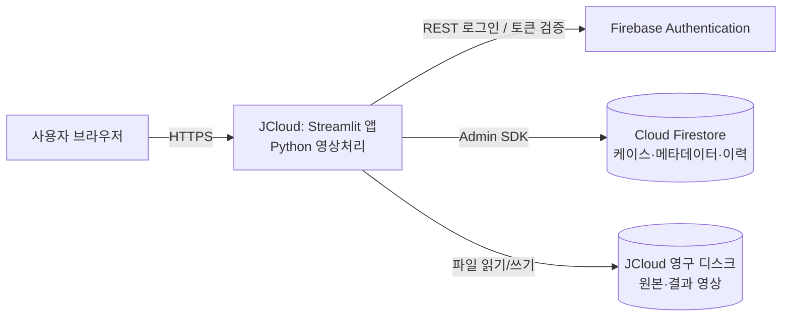
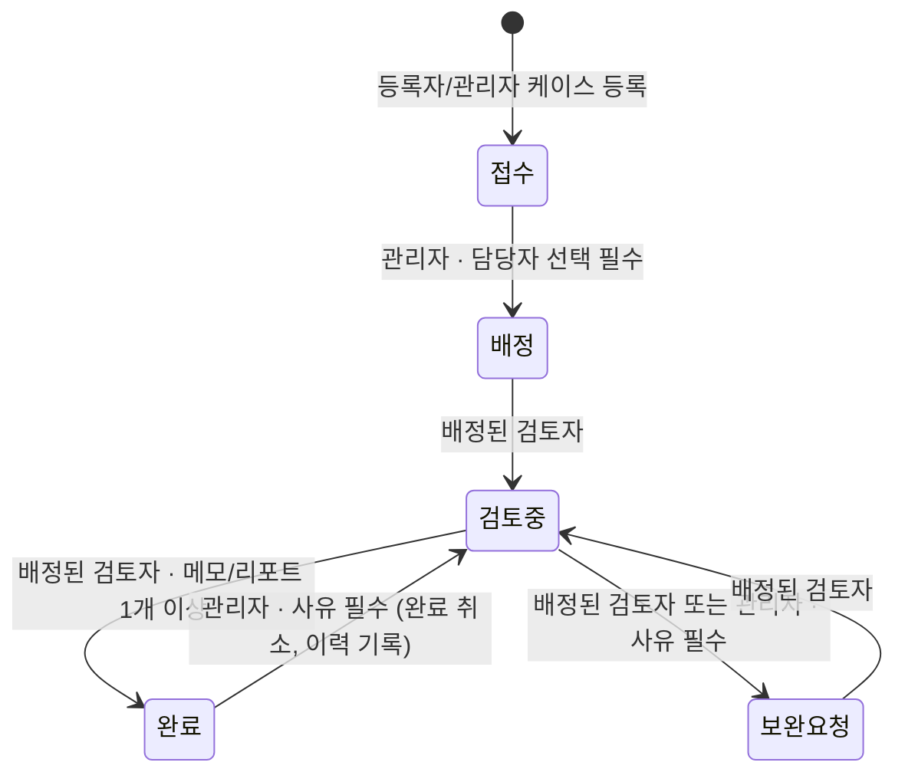

# 서비스·데이터 설계

## 1. 구성도

- 영상 **파일**은 디스크(`storage_dir`), 파일 **위치와 업무 데이터**는 Firestore에 저장합니다.
- 브라우저는 Firebase에 직접 접근하지 않습니다 (`firestore.rules` 에서 전부 차단).
- 모든 데이터 접근은 `pacs/repository.py` → `permissions.py` / `workflow.py` 검사를 거칩니다.

## 2. 역할과 권한

| 동작 | 등록 담당자 | 검토 담당자 | 관리 담당자 |
|---|---|---|---|
| 케이스 조회 | 전체 | **배정된 케이스만** | 전체 |
| 케이스 등록 | ✅ | ❌ | ✅ |
| 영상 등록 | ✅ (접수·배정·보완 요청 상태) | ❌ | ✅ (동일) |
| 담당자 배정 | ❌ | ❌ | ✅ |
| 영상 처리 결과 저장 | ❌ | ✅ (검토 중, 본인 배정) | ❌ |
| 메모·리포트 | ❌ | ✅ (검토 중·보완 요청, 본인 배정) | ✅ |

## 3. 상태전이도

코드: `pacs/workflow.py` 의 `TRANSITIONS` — 이 그림과 항상 일치시킬 것.

## 4. Firestore 구조

| 컬렉션 | 문서 ID | 주요 필드 |
|---|---|---|
| `users` | Firebase UID | email, role, display_name |
| `cases` | 케이스 ID (예: MOCK-0001) | modality, exam_date, description, status, assignee_uid, created_by, created_at, updated_at, is_mock |
| `cases/{id}/history` | 자동 | action, from_status, to_status, reason, by_uid, at, ... |
| `images` | 자동 | case_id, path, filename, format, width, height, size_bytes, sha256, source, uploaded_by, uploaded_at |
| `processings` | request_id (중복 저장 방지) | case_id, image_id, algorithm, algorithm_version, params, roi, stats, result_path, executed_by, executed_at |
| `memos` | 자동 | case_id, kind(memo/report), content, image_id, processing_id, author_uid, created_at, updated_at, edits[] |

## 5. 정합성·예외 처리

| 상황 | 처리 |
|---|---|
| 파일 저장 성공 → DB 기록 실패 | 방금 저장한 파일 삭제 (보상 처리) |
| 같은 처리 결과 저장 버튼 연속 클릭 | 화면 상태별 request_id 를 문서 ID로 사용, `create()` 로 1회만 기록 |
| 같은 영상 중복 업로드 | 케이스 내 sha256 중복 검사 |
| 동시에 상태 변경 | Firestore 트랜잭션 안에서 현재 상태 기준으로 전이 규칙 검사 |
| 원본 보호 | 결과는 항상 새 파일로 저장, 원본 경로는 수정하지 않음 |
